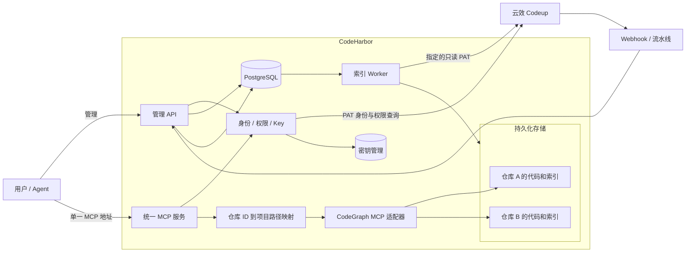

# CodeHarbor 技术设计方案

- 状态：设计草案，供评审；尚未实施或在企业环境中验证
- 日期：2026-11-07
- 目标 CodeGraph：[colbymchenry/codegraph](https://github.com/colbymchenry/codegraph)
- 适用范围：云效 Codeup 托管的 Git 仓库，默认分支的代码索引和查询

## 1. 背景与目标

WeKnora 已覆盖文档知识，CodeHarbor 用来补充代码结构知识，使 Agent 能基于代码仓库查询符号、源码片段和调用关系。系统只提供后端接口，不建设管理前端。

用户使用云效个人访问令牌（PAT）绑定 CodeHarbor，选择自己有权限的云效仓库接入。CodeHarbor 拉取代码、为每个仓库建立独立 CodeGraph 索引；代码更新后异步重建索引。多个用户通过同一个远程 MCP 地址，查询各自有权访问的仓库。

### 1.1 一期范围

- 云效 PAT 身份绑定与仓库权限查询；无需接入飞书登录。
- 仓库接入、状态查询、手动更新、Webhook 更新和定期对账。
- 一仓库一索引，多仓库共享一个 CodeGraph MCP 查询会话。
- 一个 Streamable HTTP MCP 入口，用户通过独立的 CodeHarbor API Key 认证。
- `read` 和 `write` Key：写权限仅用于 CodeHarbor 平台管理与触发索引。
- 基础审计、凭证保护、任务重试、健康检查和备份恢复。

### 1.2 不在一期范围

- 写入云效代码、Git push、创建或合并 MR。
- 多分支同时索引、跨仓库语义调用图、全文向量检索、WeKnora 内部集成。
- 对用户暴露原始服务器路径、任意 Git 地址、Shell 或原始上游 MCP 调用。
- 将云效 PAT 直接作为 MCP API Key 使用。

## 2. 已确认的上游能力及前提

1. 云效 PAT 可用于调用云效 API 和通过 HTTP 操作 Git，权限受用户实际权限与令牌权限范围共同限制。[云效 PAT 文档](https://help.aliyun.com/zh/yunxiao/developer-reference/obtain-personal-access-token/)。
2. [GetUserByToken](https://help.aliyun.com/zh/yunxiao/developer-reference/getuserbytoken) 根据 PAT 返回用户信息；[ListRepositories](https://help.aliyun.com/zh/yunxiao/developer-reference/listrepositories-query-code-base-list) 和 [GetRepository](https://help.aliyun.com/zh/yunxiao/developer-reference/getrepository-query-the-code-base) 提供代码库信息与当前用户的权限级别。不同云效版本、继承权限和实际 Git 克隆权限是否完全一致需实测。
3. CodeGraph 的 `init` 建立索引，`sync` 用于增量更新；一个 MCP 会话可用 `projectPath` 查询多个已经独立索引的项目。[CodeGraph README](https://github.com/colbymchenry/codegraph)；[CLI 文档](https://colbymchenry.github.io/codegraph/reference/cli/)。
4. CodeGraph 默认暴露 `codegraph_explore`；其他工具通过配置启用。工具 schema、行为与运行模式依赖具体版本，必须固定版本并验证。[MCP 工具文档](https://colbymchenry.github.io/codegraph/reference/mcp-server/)。
5. MCP 定义 stdio 和 Streamable HTTP。CodeHarbor 对外提供后者，内部以 MCP 客户端连接 CodeGraph 的 stdio 服务。[MCP 传输规范](https://modelcontextprotocol.io/specification/2025-11-25/basic/transports)。
6. Codeup Push Webhook 可通过 `X-Codeup-Token` 传递配置的静态 Secret Token；这是共享密钥校验，不假定是 HMAC 签名。[Codeup Webhook](https://help.aliyun.com/zh/yunxiao/user-guide/webhooks-settings)。

**版本约束**：实现前记录 CodeGraph 的具体发布版本、镜像摘要和 MCP schema；在 PoC 中验证多项目查询、启动参数、监听/进程和索引切换行为。本设计不假定任何尚未测试的上游版本满足这些条件。

## 3. 总体架构



对外是一个 MCP 服务；内部适配器作为 MCP 客户端维护一个共享上游会话，按服务端映射传入不同的 `projectPath`。一期建议先串行化上游调用，明确超时、取消和重连行为；验证固定版本的并发和会话隔离后再扩大并发。多用户的身份、鉴权结果与请求上下文始终由 CodeHarbor 管理，不能保存在可被其他用户复用的上游会话状态中。

### 3.1 模块划分

| 模块 | 职责 |
|---|---|
| 管理 API | PAT 绑定、Key 管理、仓库接入、同步任务、状态查询 |
| 云效适配器 | 按企业部署版本调用用户、仓库详情和列表接口，处理分页与错误 |
| 凭证管理 | 加密保存 PAT 和 Webhook 密钥，管理生命周期和使用授权 |
| 鉴权服务 | 校验 Key，计算用户、仓库、操作三者的有效权限 |
| MCP 服务 | Streamable HTTP、工具 schema、参数校验、授权、结果包装 |
| CodeGraph 适配器 | 管理上游 stdio 会话、工具白名单、路径映射、超时、重启 |
| 仓库与索引管理 | 仓库去重、版本目录、已发布 commit、状态与资源清理 |
| 更新调度器 | Webhook 接收、任务合并、租约、重试与定期对账 |
| 索引 Worker | 安全拉取目标 commit，执行索引，校验并准备发布 |
| 审计和监控 | 记录身份、操作、状态与错误；监控延迟、失败、容量 |

这些是逻辑模块，不要求首期拆成独立微服务。

## 4. 身份、凭证与权限模型

### 4.1 PAT 绑定与首次获取 Key

首次接入不能依赖尚不存在的 CodeHarbor Key，采用专门的引导流程：

1. 用户从受信任的本地 CLI，以隐藏输入或受保护的 stdin 输入 PAT，经 TLS 提交到专用绑定 API。不要在 Agent 聊天、命令参数、Git URL 或日志中输入 PAT。
2. 服务调用 GetUserByToken，取得经过云效确认的稳定用户 ID；检查配置的云效组织和所需访问范围。首次绑定需验证组织成员/仓库接口可用，实际判定方式在 PoC 中确认。
3. 服务将 PAT 加密存入密钥管理，建立 `云效实例 + 组织 ID + 云效用户 ID` 与 CodeHarbor 用户的关联；不以用户自报邮箱作为身份依据。
4. 服务签发短期引导凭证（建议 5 分钟、单次用途），用户使用该凭证签发首个 CodeHarbor Key。Key 的 `read`/`write` 上限由平台策略决定；持有 PAT 不自动成为平台管理员。
5. 用户将 CodeHarbor Key 配置到 Agent；原始 PAT 不再传给 Agent。

CLI 是推荐的纯后端交互入口；也可由受信任的程序直接调用 HTTPS API。引导凭证和 Key 均只在创建时返回明文，客户端应自行安全保存。

### 4.2 PAT 生命周期

- PAT 使用云效支持的最小只读授权及有效期。具体 scope 和 Git HTTPS 克隆账号格式由 PoC 确认。
- 在专用密钥管理中加密保存 PAT，密钥与数据库分离；管理接口不回显原文。
- 用户更新 PAT 时，先验证新 PAT 属于相同云效用户及组织，再原子替换凭证并增加 `credential_version`，清除其权限缓存。
- 主动解绑、PAT 被撤销/到期或云效确认身份无效时，禁用该用户的 CodeHarbor Key、清除缓存；如该 PAT 是仓库同步凭证，标记该仓库需要重新授权。网络故障不等于确认撤销，应标记校验不可用，并按缓存规则拒绝后续访问。
- 用户重新绑定同一身份的新 PAT 后，可恢复或重新签发 Key；仓库同步凭证由授权者明确重新绑定，不能静默使用其他人的 PAT。

### 4.3 用户读取与仓库更新使用不同授权

每个查询者必须绑定自己的 PAT；对共享索引的访问按查询者自身权限判断。仓库仅保留一份已发布索引，接入者不因此向其他人授予读取权限。

每个仓库另外指定一个**同步凭证**，由其持有人明确授权用于自动拉取。默认可由接入者在创建仓库时选择自己的 PAT；仅供查询绑定的 PAT 不会被自动用作共享仓库更新凭证。

同步凭证失效时停止自动更新，保留已发布版本并标记滞后；独立检查仍有权的用户可查询旧版本。由仓库平台管理员或接入负责人协调另一名凭证持有人明确授权后，重新绑定并恢复同步。

### 4.4 Key、平台角色与仓库权限

Key 用随机高熵值生成，只保存安全哈希和可识别前缀，明文仅创建时返回。包含所属用户、能力、允许仓库范围、到期时间、撤销状态和用途；Key 不包含或透传 PAT。

| 操作 | `read` Key | `write` Key | 附加条件 |
|---|---:|---:|---|
| 列出本人有权仓库及查询索引 | 是 | 是 | 当前云效仓库读取权限、Key 仓库范围 |
| 查询代码和调用关系 | 是 | 是 | 当前云效仓库读取权限、Key 仓库范围 |
| 创建仓库接入与触发同步 | 否 | 是 | 平台策略允许，且对目标仓库有云效读取权限 |
| 修改仓库配置、替换同步凭证、移除仓库 | 否 | 有条件 | 仓库接入负责人或平台管理员；新凭证持有人明确授权 |
| 管理本人下级 Key | 否 | 有条件 | 不得超过父 Key 权限、仓库范围或有效期 |
| 平台全局管理 | 否 | 否 | 单独的管理员角色，由部署时受控配置引导 |
| 写入云效代码 | 否 | 否 | 一期不支持 |

Key 的权限上限和其持有者通过 PAT 能重新申请的能力是两回事：较窄的 Key 可限制持有该 Key 的 Agent，但不能限制拥有同一用户 PAT 且被平台策略允许重新签发 Key 的人。仓库范围可为明确列表或 `all_authorized`；后者仍受实时云效权限约束。

有效查询权限：

```text
有效权限 = 有效 CodeHarbor Key 的操作和仓库范围
         ∩ 用户云效 PAT 的当前仓库代码读取权限
         ∩ CodeHarbor 平台策略
```

每次 `tools/call` 都执行检查，不能只在 MCP 初始化时鉴权。权限缓存按 `云效实例 / 组织 / 用户 / PAT 版本 / 仓库` 隔离，默认绝对 TTL 5 分钟；不做滑动续期。缓存过期时无法向云效确认权限则拒绝。云效撤权后的生效延迟以 TTL 为上限；CodeHarbor Key 主动撤销即时生效。列表、任务和错误也遵循相同访问边界，未授权仓库可统一返回 404，避免枚举。

GetRepository 或列表出现仓库不一定足以证明可读取源码：一期上线前必须验证云效角色、继承权限、组织内可见性和 Git 读取策略的对应关系；未验证时不开放给对应角色。

## 5. 仓库与索引模型

### 5.1 核心数据

| 实体 | 核心字段 | 约束 |
|---|---|---|
| User | 云效实例、组织 ID、云效用户 ID、状态 | 三者组合唯一 |
| Credential | owner、密钥引用、版本、状态 | PAT 只存密钥管理，记录明确的同步用途授权 |
| ApiKey | owner、哈希、能力、仓库范围、有效期、状态 | 只显示一次明文，可撤销 |
| Repository | 云效实例、组织 ID、云效 repo ID、分支、负责人、同步凭证、状态 | 实例 + 组织 + repo ID 唯一 |
| IndexVersion | repository ID、generation、commit、路径引用、CodeGraph 版本、状态、创建时间 | 每仓库至多一个已发布版本 |
| SyncJob | repo ID、触发来源、请求序号、状态、尝试次数、租约、错误 | 同仓库同一时刻最多一个有效写任务 |
| WebhookConfig | repo ID、密钥引用、启用状态 | 每仓库单独密钥 |
| AuditEvent | 主体、操作、资源、时间、结果、request ID | 不保存 PAT、Key 或源码正文 |

仓库显示名和路径可能更改，不用作唯一身份。初期仅配置一个受管理分支，默认 `main`；如果云效默认分支不同，可在接入时指定合法分支。

### 5.2 目录结构

```text
/data/codeharbor/
  repositories/<internal-repo-id>/
    versions/<generation>/
      worktree/              # 指定 commit 的代码和 .codegraph 索引
    staging/<job-id>/        # 尚未发布的候选版本
```

路径由服务端生成，客户端不可指定。每个版本使用不可变的绝对路径；数据库记录当前版本，查询只指向当前已发布的 generation。清理前确认没有正在使用旧 generation 的请求。

代码、索引和备份都按源码敏感级别管理。仓库移除采用软删除并停止查询和同步；数据清理通过受控管理操作完成，定义备份留存期限。

## 6. 管理 API 设计

路径前缀 `/api/v1`；正式接口需提供 OpenAPI。HTTPS；除绑定引导和 Webhook 外，均使用 `Authorization: Bearer <CodeHarbor Key>`。以下字段和响应为设计契约，不是现有实现。

| 方法与路径 | 用途 | 权限 |
|---|---|---|
| `POST /auth/yunxiao/bind` | 提交 PAT，验证用户并返回短期引导凭证 | 未登录；严格限流与 TLS |
| `POST /auth/bootstrap/keys` | 使用单次引导凭证创建首个 Key | 引导凭证 + 平台签发策略 |
| `GET /me` | 查看当前用户和 PAT 状态 | read |
| `PUT /me/yunxiao-credential` | 更新自己的 PAT，同身份校验 | write 或再次 PAT 身份验证 |
| `DELETE /me/yunxiao-credential` | 解绑 PAT 并使关联权限失效 | 当前身份重新验证 |
| `GET /codeup/repositories` | 按当前用户 PAT 列出可见云效仓库，支持分页 | read |
| `GET /repositories` | 列出已接入且当前用户可访问的仓库 | read |
| `POST /repositories` | 按云效仓库 ID 接入并创建初始化任务 | write + 仓库读取权限 + 平台接入策略 |
| `GET /repositories/{id}` | 查询仓库及已发布索引状态 | read + 仓库权限 |
| `POST /repositories/{id}/sync` | 提交刷新任务 | write + 仓库权限 + 管理策略 |
| `PUT /repositories/{id}/sync-credential` | 指定同步凭证 | 仓库负责人/管理员 + 凭证持有人明确授权 |
| `DELETE /repositories/{id}` | 停用并发起清理 | 仓库负责人或管理员 |
| `GET /jobs/{id}` | 查询任务状态和安全错误信息 | 发起人或仓库负责人/管理员，并检查仓库权限 |
| `POST /api-keys` | 创建本人下级 Key | write；仅可签发父 Key 权限子集 |
| `GET /api-keys` | 列出本人 Key 元数据 | read |
| `DELETE /api-keys/{id}` | 撤销本人 Key | write，或持有者经 PAT 重新验证 |
| `POST /hooks/codeup/{hook_id}` | 接收 Codeup Webhook | 独立 Webhook Token，不使用用户 Key |
| `GET /health/live`, `GET /health/ready` | 进程和依赖健康检查 | 仅内网或运维访问 |

### 6.1 接入仓库示例

```http
POST /api/v1/repositories
Authorization: Bearer <CODEHARBOR_WRITE_KEY>
Content-Type: application/json
Idempotency-Key: <client-generated-id>

{
  "codeup_repository_id": 12345,
  "branch": "main",
  "sync_credential": "my_bound_credential",
  "authorize_automatic_sync": true
}
```

返回 `202 Accepted`、`repository_id`、`job_id` 和 `status=queued`。客户端使用 `GET /jobs/{id}` 查询；同用户、同请求体、同 Idempotency-Key 返回原任务，不同请求体复用该 Key 返回冲突。重复接入同一个云效仓库返回现有仓库及授权状态，不创建第二份索引，不泄露未授权仓库信息。

### 6.2 响应、分页和错误

- 列表 API 使用 cursor/limit 分页；云效适配器负责转换上游分页，最终先鉴权再返回。任务操作异步返回 `202`。
- 通用错误：`400 INVALID_ARGUMENT`、`401 UNAUTHENTICATED`、`404 NOT_FOUND`（包括无权或不存在）、`409 CONFLICT`、`429 RATE_LIMITED`、`503 UPSTREAM_UNAVAILABLE`。响应包含 `request_id`；不返回内部路径、PAT 或上游敏感报错。
- `GET /repositories/{id}` 返回 `branch`、`status`、`indexed_commit`、`indexed_at`、`last_sync_status`、`stale` 和最近安全错误摘要。后台有新版本构建时，旧版依然可标记为 `stale`。
- 对于注册仓库、触发同步等调用，网络重试应结合幂等键或服务端任务合并，避免重复执行。

## 7. MCP 接口设计

### 7.1 传输与认证

- 对外入口：`https://<codeharbor-host>/mcp`，使用 Streamable HTTP；客户端通过 Bearer CodeHarbor Key 认证。API Key 是本产品的访问方式，不声称它等同于 MCP 标准 OAuth 自动发现；如客户要求 OAuth，另行实现。
- 使用 MCP SDK 完成初始化、JSON-RPC、HTTP GET/POST、会话、取消及版本协商；校验 `Origin`、TLS 和允许的主机。兼容目标客户端的协议版本必须在 PoC 中确认。
- 每个 HTTP 请求及每次工具调用验证 Key 和会话归属；Key 撤销后不因长期连接继续生效。
- 上游仅暴露内部 stdio，不暴露公网；不转发客户端任意 `projectPath`、roots、resources、prompts、工具或命令。工具采用明确的只读白名单。

### 7.2 工具契约

| CodeHarbor MCP 工具 | 输入 | 作用 |
|---|---|---|
| `list_repositories` | `cursor?`, `limit?` | 列出当前 Key 和用户可访问的已接入仓库 |
| `get_repository_status` | `repo_id` | 获取索引 commit、更新时间、状态和滞后提示 |
| `codegraph_explore` | `repo_id`, `query` | 查询相关源码、代码关系和上下文 |
| `codegraph_search` | `repo_id`, `query`, `limit?` | 查询仓库符号，选配 |
| `codegraph_callers` | `repo_id`, `symbol`, `limit?` | 查询调用方，选配 |
| `codegraph_callees` | `repo_id`, `symbol`, `limit?` | 查询被调用方，选配 |
| `codegraph_impact` | `repo_id`, `symbol`, `depth?` | 查询影响范围，选配 |

表中为 CodeHarbor 对外拟定的稳定契约，具体参数须映射并限制到**固定上游版本的真实 schema**。默认优先只开放前三项；如开放其他 CodeGraph 工具，需配置对应的 `CODEGRAPH_MCP_TOOLS`，启动时 `tools/list` 检查名称和 schema，发现不兼容则 readiness 失败，不盲目透传。

结果包装示例：

```json
{
  "repo_id": "repo_01",
  "indexed_commit": "<commit-sha>",
  "indexed_at": "2026-11-07T03:00:00Z",
  "stale": false,
  "result": "<CodeGraph 返回的查询结果>"
}
```

MCP 工具的实际返回需符合协议 `content` / `structuredContent` 约定；上述为结构示意。限制输入长度、输出大小、执行时间和用户并发；超时/取消需传播到上游或明确中断连接并恢复。CodeGraph 可能以正常文本返回“无索引”等提示，因此不能只看 `isError` 判断业务成功。

### 7.3 查询隔离

1. 认证并检查当前 Key 状态及操作范围。
2. 对 `repo_id` 计算用户云效权限；禁止客户端输入本地路径。
3. 读取数据库中的已发布 generation，映射到服务端控制的绝对路径。
4. 仅调用经过审核的 CodeGraph 查询工具，在服务端填入 `projectPath`。
5. 返回限定大小的结果和该 generation 对应的 commit；清理内部路径及敏感错误。

对于仓库列表与未来的跨仓库查询，必须先过滤有权仓库，再执行查询和聚合。一个 MCP 会话可依次查询多个独立索引，不代表自动建立跨仓库调用图。

## 8. 索引更新与发布

### 8.1 触发来源

- 仓库首次接入。
- 用户手动触发。
- Codeup 对受管理分支的 Push Webhook；通过 `ref` 筛选，覆盖正常推送和合并后分支更新。
- 定期对账远端分支与 `indexed_commit`。
- 若公司需要等待 CI 成功，也可用流水线调用受限刷新接口；不与 Webhook 重复部署为默认触发源。

### 8.2 Webhook 接收

1. 对单仓库的 `hook_id` 查找配置，使用常量时间比较校验 `X-Codeup-Token`；HTTPS、请求体大小和来源网络规则由部署层控制。
2. 校验事件类型、仓库 ID、组织和 `refs/heads/<受管理分支>`。删除分支应标记异常，禁止发布空索引。
3. 事务内将仓库标记为待检查、增加请求序号并创建或合并待执行任务；持久化成功后返回 2xx，失败返回非 2xx 供上游处理。Webhook 不同步执行 Git 或索引。
4. `after` commit 仅作为提示和审计上下文；Worker 以可信远端实际分支 HEAD 为准。静态 token 不提供消息签名或可靠防重放，故重复通知只会合并为刷新意图，并限制频率。

不要永久按 `repo + after_sha` 去重：强推或回滚后可能再次出现相同 SHA。若实际投递含可靠唯一 ID，可在短期限内按 ID 去重；仍需定期对账。

### 8.3 Worker 与一致性：一期默认全量候选版本

为保证结果中的源码与索引对应同一个 commit，一期采用**独立候选目录 + 全量 `init`**，不在对外查询的目录中 `git pull`：

1. 从数据库认领任务，取得仓库租约及单调递增的 fencing token；同仓库只允许一个有效构建。租约到期或 Worker 崩溃时允许重领，旧 Worker 即使恢复也不能发布。
2. 验证仓库未停用、同步凭证持有人仍明确授权且 PAT 有效。调用云效获取仓库可信克隆地址，只允许配置的云效域名和 HTTPS；Git 凭证通过安全的临时凭证助手提供，不写 URL、参数、日志或持久化 Git 配置。
3. 在隔离的 staging 目录拉取当前远端分支并解析 commit，检出该精确 commit。默认不执行仓库代码、Git hooks、submodule 或 LFS；如企业仓库需要它们，单独设计授权和验证。
4. 在候选目录运行固定版本的 `codegraph init`；记录版本、commit、耗时、错误和覆盖范围。运行 `codegraph status --json --strict` 及代表性查询，并检查进程退出、索引文件和代码 HEAD；`status` 成功不保证所有语言和文件均完整解析，必须记录可观测的跳过/解析错误并用样例验证。
5. 发布前再次查询远端 HEAD。如果已变化，将候选标记为过时并合并新任务；持续高速提交时监控构建饥饿，并根据业务需要调整策略。比较的是服务端最新解析结果，不相信事件到达顺序或 SHA 大小。
6. 发布期进入全局查询短暂排空：停止接收新 CodeGraph 查询，等待在途请求结束；由适配器关闭并确认其受管上游会话及可能存在的 daemon 已退出，释放旧索引句柄。切换数据库中的当前 generation，重新启动共享会话并用新版本执行健康查询，成功后恢复流量。
7. 发布时事务检查 job 租约、fencing token、仓库状态和预期旧 generation；不满足则拒绝发布。若启动/验证失败，恢复旧 generation、重启旧查询会话并告警；数据库记录发布阶段，进程重启后按记录恢复。
8. 更新 `indexed_commit`、`indexed_at` 和状态；如果期间出现新通知，再排队处理。旧版本在无引用后按保留策略清理。

**关键实现前提**：CodeGraph 可能缓存项目及 SQLite 句柄，还可能启动独立 daemon；不能假定替换软链接、文件或数据库会使它重新打开索引。必须在所选版本实测并实现受控关闭所有相关进程、排空和重启；如无法证明可靠，则不能声称切换原子或安全。候选构建目录绝不通过复制正在写入的 SQLite/WAL 制作。

此方案用更多磁盘和构建时间换取清晰的一致性；一次发布可能短暂停顿所有仓库查询。将来可评估隔离进程或经过验证的无停机切换。`sync` 增量更新作为后续优化，必须先证明生成候选版本的代码、索引和 SQLite 状态一致，并覆盖并发、失败和回滚测试。

### 8.4 状态与异常

仓库状态：`pending` → `indexing` → `ready`；有旧版且更新中为 `updating`；凭证失效为 `credential_required`；无可用版本且失败为 `failed`；停用为 `disabled`。`ready` 不代表实时最新，需检查 `stale` 和 commit。

- Webhook 丢失：定期对账触发同步；默认建议 15 分钟，实际时效需评审。
- 短暂云效或网络故障：指数退避和次数上限，保留上次成功版本。
- PAT 过期/撤销：停止以该凭证拉取，标记需要重新授权；读取者仍须通过各自的云效鉴权。
- Git 分支删除、仓库不可访问：不覆盖已发布版本，标记异常并告警。
- 更新失败、磁盘不足、解析失败：不发布候选，保留旧版本并暴露错误摘要。
- 强制推送和回滚：重新以远端实际 HEAD 构建；不能使用提交时间或 SHA 判断先后。
- CodeGraph 会话退出：查询返回可重试错误，后台重启并验证，不返回未完成的结果。
- 查询中的源码内容可能包含提示注入，必须视作不可信数据；CodeHarbor 不执行仓库中提供的命令或指令。

## 9. 部署方案

### 9.1 一期部署

建议单机或单节点容器部署，先保持实现简单：

```text
反向代理 / TLS
  └── CodeHarbor API + MCP Gateway：1 实例
       └── 受控 CodeGraph MCP 运行环境：1 个共享查询会话

CodeHarbor Worker：1 实例
PostgreSQL：1 实例（或企业托管数据库）
密钥管理：企业现有 KMS / Vault
持久化本地磁盘：仓库版本、候选索引
```

逻辑上拆分 API/MCP 和 Worker；两者访问同一持久化目录。数据库负责可靠任务记录、租约和元数据，一期不依赖额外消息队列。单机部署存在单点故障；不承诺高可用。需要跨主机扩容前，重新设计共享存储语义、分布式查询排空、进程协调和 fencing，不应仅增加副本数。

- 部署时固定 CodeGraph 版本和镜像摘要，禁止运行期自动升级；核验并关闭不需要的遥测及更新检查，限制运行期外网访问。[CodeGraph 遥测说明](https://github.com/colbymchenry/codegraph/blob/main/TELEMETRY.md)。
- 使用非 root 身份、受限文件系统、CPU/内存/磁盘/进程限额；Worker 对代码仓库视为不可信输入，不挂载 Docker socket 或宿主敏感目录。
- 独立控制 Git 出网域名、云效 API、Webhook 入站和管理入口；仓库中符号链接、包含路径、解析器对仓库外文件访问的限制必须实测。高敏感仓库后续可使用独立容器/进程隔离，不改变外部 MCP 地址。
- 候选构建需要额外空间：容量至少覆盖活跃版本、一个候选版本和按策略保留的旧版本，并监控构建峰值；实际配额由试运行数据决定。
- CodeGraph 的后台进程和 watcher 是否可关闭、是否写入候选目录、查询目录是否支持只读挂载，均须针对固定版本验证。不能仅靠监听器证明索引对应目标 commit。

### 9.2 配置项

```text
CODEHARBOR_PUBLIC_URL              # 管理 API 和 MCP 对外根地址
YUNXIAO_ENDPOINT                   # 配置允许访问的云效 API 实例
YUNXIAO_ORGANIZATION_ID            # 企业组织 ID；按部署版本使用
CODEHARBOR_DATABASE_URL            # 引用数据库连接密钥，不写入代码库
CODEHARBOR_DATA_DIR                # 持久化数据目录
CODEHARBOR_SECRET_BACKEND          # 企业密钥管理配置引用
CODEGRAPH_VERSION                  # 已验证并锁定的版本
PERMISSION_CACHE_TTL_SECONDS       # 默认建议 300
RECONCILE_INTERVAL_SECONDS         # 默认建议 900
MAX_INDEX_WORKERS                  # 初期建议 1，根据资源调整
```

具体配置字段和默认值为设计建议，并非现成环境变量。生产部署中将凭证存放于密钥管理，不提交配置文件或打印在启动日志中。

### 9.3 备份、恢复与升级

- 备份 PostgreSQL 元数据和密钥管理中的必要密钥；验证密钥恢复权限和轮换流程。索引可从云效重建，但要明确重建时间和存储成本。
- 如备份源码/索引，使用一致性快照或停写后备份；不要直接复制活动 SQLite 文件而忽略 WAL。备份需加密、限制访问并有明确留存期。
- 恢复后核对仓库状态、已发布 generation 路径、密钥可用性和 commit；恢复完成前关闭查询或返回不可用。若版本文件缺失，则重新建立索引。
- 升级 CodeGraph 前在隔离环境验证旧索引兼容、工具 schema 和查询结果；必要时全量重建。数据库迁移要有备份与回滚路径。

### 9.4 可观测性

最少监控：接入/同步成功率、任务队列时间、索引耗时、最后成功更新时间、远端与索引 commit 是否一致、凭证失效数、权限查询失败率、MCP 错误/延迟、磁盘容量、CodeGraph 重启次数。

审计记录用户、Key 标识、仓库、操作、结果、时间和 request ID；默认不记录 PAT、Key、完整代码、查询结果或完整 Webhook 密钥。源码可能经 MCP 输出给外部 Agent/模型，需按公司现有数据使用政策控制模型接收与日志留存。

## 10. 关键验收与测试

### 10.1 云效与身份 PoC

- 用两个以上不同权限的真实测试账号，验证 PAT 身份查询、最小 scope、仓库列表分页、详情权限和 HTTPS clone。
- 覆盖仓库直接授权、代码组继承、组织内可见、仓库浏览者、撤权及 PAT 撤销/过期；确认返回的用户 ID 与组织归属可靠。
- 证明无权账号无法查询已索引仓库，也无法通过仓库 ID、任务、Key 范围或路径推测访问。

### 10.2 功能与隔离

- 两个仓库分别建立索引，一个 MCP 地址在一次客户端会话中按 `repo_id` 依次查询；验证工具调用与真实 schema 匹配。
- 不同用户使用同一索引，读取权限互不影响；同仓库重复接入不产生第二份索引。
- `read` Key 无法触发更新；`write` Key 不能执行 Git 写入或越过仓库管理员限制；下级 Key 不可升权。
- Key 被撤销、PAT 更新及权限缓存到期后，已建立的 MCP 连接不能绕过检查。
- 验证路径遍历、绝对路径、符号链接、未经允许的子模块、非法参数和异常工具调用不能读取其他仓库或宿主文件。

### 10.3 更新与恢复

- 测试连续 Push、重复及乱序事件、Webhook 丢失、分支回滚/强推、分支删除、远端读取失败。
- 验证同仓库并发触发只有一个有效写任务；Worker 租约超时后旧任务无法发布。
- 在构建、发布、数据库切换和上游重启的各阶段模拟崩溃，确认恢复后只会服务可验证的已发布版本。
- 使用有代表性的代码验证 `indexed_commit`、工作树源码、CodeGraph 查询结果一致；记录不同语言的覆盖率与解析失败。
- 测试两个目标 Agent 的 MCP 连接、Key 撤销、并发、超时、取消和共享会话断线恢复。

## 11. 风险与待验证事项

| 问题 | 决策或验证方式 |
|---|---|
| 云效版本、PAT 权限项和身份 API | 在企业实际实例验证接口、组织 ID、克隆账号及最小授权 |
| 云效权限查询是否等价于源码读取 | 分角色及继承、可见性、特殊克隆策略实测；未验证则拒绝该角色 |
| CodeGraph 多项目监听、缓存和进程行为 | 锁定版本；验证显式 `projectPath`、watcher、daemon、发布后句柄释放。此前多项目同步问题的处理状态参见 [上游 issue](https://github.com/colbymchenry/codegraph/issues/1835) |
| CodeGraph 工具文档与实际版本差异 | 启动时校验上游 `tools/list`；以固定版本实测为准 |
| 全量构建性能与发布停顿 | 用真实大仓库测 CPU、内存、磁盘、耗时和查询中断；如不能满足需求再设计增量/无停机切换 |
| 个人同步 PAT 失效 | 标记滞后并提示重新授权；不自动使用其他人的 PAT |
| 同步期间不断提交导致候选过时 | 测试任务合并与饥饿；必要时评审允许发布落后版本的条件 |
| 单节点故障 | 首期接受单点；建立备份恢复演练，再评估多节点设计 |
| MCP 客户端兼容性 | 测试用户实际使用的 Agent 对 Streamable HTTP、Bearer、会话和重连的支持 |

## 12. 实施阶段

1. **PoC**：固定 CodeGraph 版本；以测试云效 PAT 获取身份与仓库权限、拉取两个仓库、分别 `init`，从同一上游 MCP 会话查询并验证隔离和一致性。输出实测数据和版本记录。
2. **最小可用版**：实现绑定与 Key、仓库管理、共享 MCP 适配器、权限校验、单 Worker 全量构建、手动更新和 Webhook、状态和审计。
3. **生产准备**：完成回滚与崩溃恢复、凭证轮换、对账、容量监控、备份恢复、权限撤销和目标客户端验收。
4. **按需扩展**：经过验证后优化增量构建、无停机发布、跨仓库搜索、高敏感仓库隔离及多节点部署。
